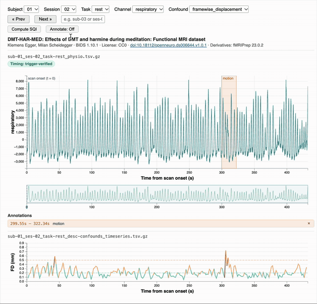

# physAI-QA-interactive

[](https://doi.org/10.5281/zenodo.19389717)

**An interactive visualization and annotation tool for physiological recordings in BIDS fMRI datasets.**

physAI-QA-interactive lets you step through every scan of a BIDS dataset, view cardiac, respiratory and other physiological signals on one time axis anchored at scan onset, check that alignment against scanner trigger pulses, compare it with fMRIPrep motion confounds, compute per-channel signal quality metrics, and mark artifacts as annotations saved next to the dataset. A second page compares signal quality metrics across every scan of a dataset and exports them as a PDF report.

It is part of **physAI**, a research suite for physiological data. This repository, **physAI-QA-interactive**, is the manual data exploration and annotation tool of **physAI-QA**, the suite's quality assurance component. Coming next: **physAI-QA-auto**, for automated artifact detection, annotation and correction.

The viewer is built on a reusable D3 + TypeScript chart library with **zoom/pan**, **brush selection**, **viewport culling** and a **focus+context** layout for dense time-series signals (see [CONTRIBUTING.md](CONTRIBUTING.md#chart-library-usage)).



## Quick start

```bash
npm install
npm run dev        # Vite dev server with hot reload
```

### Getting the data

```bash
brew install git-annex
uv tool install datalad
datalad install -s https://github.com/OpenNeuroDatasets/ds006644.git data/ds006644
cd data/ds006644
datalad get sub-*/ses-*/func/*_physio.*
datalad get derivatives/fmriprep/sub-*/ses-*/func/*_desc-confounds_timeseries.*
```

Optional: `git annex adjust --unlock` checks files out as regular files instead of symlinks. The viewer doesn't need it, but it helps with tools that don't follow symlinks.

Open the URL Vite prints (usually `http://localhost:5173`).

To use the dataset quality metrics page, compute the metrics once per dataset (see [Dataset quality metrics](#dataset-quality-metrics)):

```bash
npx vite-node scripts/compute-quality-metrics.ts ds006644
```

## Features

The app loads a BIDS physiology dataset and presents an interactive viewer with:

- **Controls** — three rows: Subject, Session, Task, Run (when present) and Channel dropdowns; an **Auxiliary Signal Options** row with the Confound dropdown (when derivatives exist) and Stack checkboxes for extra channels, for the Auxiliary charts below (Channel and Stack offer only physiological channels, matched against the same dictionary as the quality metrics, so `trigger` is left out); Prev/Next buttons (or ←/→ keys) to step through scans in hierarchy order plus a search bar accepting `sub-03` or `ses-012` style input. The Annotate: On/Off button is in the Annotations box, under Time Windows
- **Dataset info** — name, authors, BIDS version, license, DOI link and derivatives pipeline/version, read from the dataset's own `dataset_description.json` (raw and derivatives); fields that are missing are skipped
- **Filename display** — shows the exact `.tsv.gz` file being viewed
- **Badges** — next to the file name: a timing badge (see [Timing alignment](#timing-alignment)) and per-channel pass/fail quality indicators when a `_desc-quality.json` sidecar is present (run-level, e.g. `*_run-01_desc-quality.json`, or run-less)
- **Focus chart** (top) — drag to brush-select a time window (zooms on release), double-click to reset, auto-fits Y-axis to visible data; hover for data readout
- **Context chart** (bottom) — drag the brush to navigate; handles resize the viewport
- **Stacked channels** — tick channels in the Stack row to add a compact figure for each, stacked below the annotations; they follow the focus chart's time window (zoom, brush, double-click reset), auto-fit their Y-axis to visible data, and have their own hover readout
- **Confounds chart** — pick a motion confound from the Confound dropdown (shown only when fMRIPrep derivatives exist); FD is color-coded by severity (green/amber/red) with 0.2 mm and 0.5 mm reference lines
- **Channel persistence** — selected channel and stacked channels are preserved when stepping through scans with Prev/Next; a reload keeps the channel, stacked channels and confound (saved per dataset in the browser's localStorage)
- **Where it opens** — on the earliest scan (subject, session, task, run order) with nothing annotated yet for the remembered channel, so a skipped scan always comes back; once every scan is annotated, on the last-viewed scan. A link from Stats (`/#scan?sub=…`) opens that scan instead
- **Annotations** box — *Full Recording*: rate the Signal Quality (Good, Bad, Fixable, Unknown) and write Notes; *Time Windows*: toggle Annotate mode, drag on the focus chart to mark and label a time window. Everything is saved to disk per `{sub, ses, task, run, channel}` (signal quality and notes first in the file) and reloads automatically when you return to that scan

## Dataset quality metrics

The app has two folder tabs at the top: **Explore and Annotate** (the viewer above, `/`) and **Stats** (`/quality.html`). Once a dataset's signal quality metrics are computed, Explore and Annotate also shows a scatter plot comparing them across every scan, and the Stats tab appears. Without them, both stay hidden.

**1. Compute the metrics** (once per dataset, and again after the data or the metrics change):

```bash
npx vite-node scripts/compute-quality-metrics.ts <dataset>      # folder name under data/, e.g. ds006644
npx vite-node scripts/compute-quality-metrics.ts mydata --bids-root /path/to/bids --deriv-root /path/to/derivatives/fmriprep
```

The script runs the per-channel signal quality metrics (`src/data/sqi-metrics.ts`) on every readable scan and writes `data/quality/<dataset>/`:

- `quality_metrics.tsv`: one row per scan and physiological channel (`n/a` where a metric does not apply)
- `dataset.json`: dataset description, scan and subject counts, `participants.tsv` and its descriptions, scans that could not be computed, and excluded channels
- `waveforms/`: a downsampled waveform per scan for the plots

Only physiological channels are computed. Column names are checked against a dictionary (`src/quality/channels.ts`; e.g. `cardiac`, `PPG`, `ECG`, `respiratory`, `RSP`, `EDA`); `trigger` and unknown columns are skipped. Datasets with the raw data in `physprep/` next to `fmriprep/` (e.g. CNeuroMod) are detected automatically. Output is deterministic: the same input gives byte-identical files.

**2. Reload the page.** Both tabs show the dataset the dev server is serving (`BIDS_ROOT`, see [Using your own dataset](#using-your-own-dataset)). The scan open in Explore and Annotate is the one Stats opens, and the other way round.

- **Scatter plot** (bottom of Explore and Annotate): shows the channel chosen in the page's one Channel dropdown, the same as the charts above it; pick Y, X and colouring. Y is a metric, X can be a metric or a participant variable such as age or sex. The menus list every metric in `quality_metrics.tsv` that has values for that channel; a channel without metrics (e.g. `trigger`) gets a short message instead of a plot. Colour by offers only what the dataset has (task, session, timing check, sidecar pass/fail). The scan you are viewing is the larger pinkish-red point. Hover a point for details; double-click it to open that scan in Stats.
- **Stats:** one scan at a time (Prev/Next): file name, participant info, recording details, the waveform of each physiological channel, and per channel a table of its metrics with percentiles, followed by where the scan sits in each metric's histogram.
- **Metrics shown** (Stats): tick which metrics the tables and histograms show, listed under their groups (Basic, Distribution, PaPaGei, PhysioQC), or use Show all / Hide all. The choice is remembered in your browser.
- **PDF report:** `data/quality/<dataset>/quality_report.pdf`, with a summary, each channel's scatter plot and one page per scan with its waveforms and every metric. Computing the metrics deletes the old report; the next time Stats opens it builds a new one in the background and the dev server saves it there. The Stats sidebar shows its progress and then a link to open it.

What each metric computes, and its source, is described in [REVIEW.md](REVIEW.md).

## Timing alignment

All charts share one time axis: **t = 0 is scan onset**, the start of acquisition of the first BOLD volume. All charts start at t = 0, and their x-axis reads "Time from scan onset (s)". Physio recorded before the scan (negative times) is out of view. A dashed purple **scan onset (t = 0)** marker marks the start.

- **Physio.** The physio sidecar's `StartTime` is the reference. Per BIDS, it is the time of the first physio sample relative to the first volume, so sample *i* sits at `StartTime + i / SamplingFrequency`. It is often negative because recording starts before the scan.
- **Confounds.** fMRIPrep writes one confounds row per volume. Volume *i* sits at `VolumeTiming[i]`, or `i × RepetitionTime` if there is no `VolumeTiming`. The server looks for these in the raw BOLD sidecar (scan-level, then top-level `task-<task>_bold.json`), then in the derivatives' BOLD sidecars. If none of them has timing, volumes are spread evenly across the physio recording. That fallback is only approximate.
- **Trigger check.** If the physio file has a `trigger` channel, the server detects its pulses (rising edges at the midpoint of the channel's range) and checks them against the sidecar timing. Triggers are a cross-check, not the reference: the first pulse is not assumed to be the first volume, because dummy scans, dropped pulses or recording delays can break that.

The **Timing** badge above the chart shows the result. Hover over it to see the details.

| Badge | Condition | What the viewer does |
|---|---|---|
| trigger-verified (green) | Every pulse interval is within 5% of TR, pulse count equals volume count, and the first pulse lands at t = 0 (within 5% of TR) | Uses `StartTime` as-is |
| corrected from triggers (amber) | Pulses are clean (spacing and count match) but the first pulse is off from t = 0 | Shifts the physio axis so the first pulse is at t = 0 |
| triggers disagree (red) | Some intervals differ from TR, or the pulse count doesn't match the volume count | Uses `StartTime` as-is and flags the scan for review |
| sidecar only (amber) | No trigger channel or pulses, or no BOLD TR to check against | Uses `StartTime` as-is, unverified |

In ds006644, 79 of 80 scans are trigger-verified. sub-18 ses-02 is flagged red: 21 of its pulse intervals differ from TR, the first being 0.704 s against 1.8 s.

## Using your own dataset

`BIDS_ROOT` defaults to `data/ds006644` in the project root; set it to use another dataset. The server auto-discovers subjects, sessions, tasks, and runs from the directory structure.

```bash
BIDS_ROOT=/path/to/your/dataset BIDSDER_ROOT=/path/to/derivatives npm run dev
```

Datasets that keep the raw data in `physprep/` next to `fmriprep/` (e.g. CNeuroMod `shinobi`, `movie10`) can be given by their folder: `BIDS_ROOT=data/shinobi npm run dev` uses `data/shinobi/physprep` and `data/shinobi/fmriprep`.

Requirements:

- Standard BIDS layout: `sub-XX/ses-XX/func/*_physio.tsv.gz` or session-less `sub-XX/func/*_physio.tsv.gz`
- JSON sidecar with `SamplingFrequency`, `StartTime`, `Columns` (per-file or top-level)
- TSV can have a header row (auto-detected and skipped)
- For confound timing: a BOLD sidecar with `VolumeTiming` or `RepetitionTime` (raw scan-level, top-level `task-<task>_bold.json`, or derivatives)
- Run labels are compared as numbers between raw and derivatives, so `run-01` matches `run-1`

Annotations are saved under `data/annotations/` by default; set `ANNOTATIONS_ROOT` to store them elsewhere.

The Stats tabs show the same dataset, using the metrics computed for it under `data/quality/<name>/`, where `<name>` is the dataset's folder under `data/` (e.g. `BIDS_ROOT=data/shinobi/physprep` → `shinobi`). For a dataset outside `data/`, compute its metrics with `--bids-root` and the same name the server uses: the folder name of `BIDS_ROOT`, or set `DATASET_NAME`.

## Contributing

Architecture, server API, the chart library's API reference, how to add a metric and the TODO list are in [CONTRIBUTING.md](CONTRIBUTING.md). The metric definitions and open review items are in [REVIEW.md](REVIEW.md), and the user study task sheet is [docs/user-study.md](docs/user-study.md).

## Citation

If you use this software, please cite it using its DOI: [10.5281/zenodo.19389717](https://doi.org/10.5281/zenodo.19389717). GitHub's **Cite this repository** button (from [CITATION.cff](CITATION.cff)) gives APA and BibTeX formats.

## AI disclosure

Code in this repository was generated with Anthropic's Claude (Claude Opus 5.5, via Claude Code). The lead author reviewed and manually approved all changes.

## License

Released under the [MIT License](LICENSE).
